# Mapa velikih cjelina platforme Distill Intelligence

Distill je švedska platforma koja prati vijesti o kompanijama i temama, spaja iste vijesti iz više izvora, piše kratke sažetke, ocjenjuje važnost svake vijesti i šalje korisniku samo ono što je bitno. Ovaj dokument dijeli platformu na 15 velikih cjelina po funkcionalnostima: 10 u aplikaciji i 5 na javnom sajtu.

- **Stanje na dan:** 23.10.2026.
- **Izvori:** probni nalog na `app.distillintelligence.com` (otvoren 22.10.2026) i javni sajt `distillintelligence.com`. Slike ekrana su sačuvane van repoa.
- **Issue:** #6

## Pregled

Pojednostavljen prikaz kako su cjeline povezane. Ovo nije arhitektura sistema, nego put od izvora do korisnika onako kako ga korisnik vidi.

```mermaid
flowchart LR
    subgraph IZVORI["Izvori"]
        S1["Sajtovi i newsroom-i kompanija"]
        S2["LinkedIn stranice kompanija"]
        S3["Mediji, i lokalni na drugim jezicima"]
    end

    subgraph OBRADA["Obrada"]
        P1["Spajanje istih vijesti"]
        P2["Sažetak i kategorije"]
        P3["Ocjena važnosti"]
        P4["Prevod na engleski"]
    end

    subgraph PRACENJE["Šta korisnik prati"]
        T1["Kompanije"]
        T2["Watchlist-e"]
        T3["Teme"]
    end

    subgraph PRIKAZ["Šta korisnik dobija"]
        O1["Feed vijesti"]
        O2["Sažeci"]
        O3["Izvještaji i PDF"]
        O4["Mejlovi i upozorenja"]
        O5["API"]
    end

    IZVORI --> OBRADA --> PRACENJE --> PRIKAZ
```

## Cjeline u aplikaciji

| # | Cjelina | Šta radi | Kome služi | Gdje se nalazi |
|---|---|---|---|---|
| 1 | **Feed vijesti** | Prikazuje vijesti o svemu što korisnik prati, grupisane po danu. Svaka vijest ima naslov, kratak sažetak, kategorije (Product, Finance, Expansion, People, Sustainability...) i ikonice izvora koje vode na original. Filter bira samo važne (**Notable**) ili sve vijesti, a postoje tri načina prikaza. | svakome ko prati kompanije | **Latest news**, kartice **Updates** i **Articles** |
| 2 | **Praćenje kompanija** | Profil svake praćene kompanije: osnovni podaci, AI sažetak za zadnji period sa numerisanim izvorima, vijesti i konkurenti. Za svaku kompaniju posebno se uključuju mejl upozorenja ili se praćenje prekida. | analitičarima, prodajnim timovima, investitorima | **Companies** → stranica kompanije, kartice **Overview**, **Summary**, **Updates**, **Articles**, **Competitors** |
| 3 | **Dodavanje kompanija** | Kompanija se bira sa ponuđene liste ili dodaje preko adrese sajta, jedna po redu, do 50 tokom probnog perioda. Nova kompanija je dostupna u roku od 24 sata, a Distill odmah povuče i njene ranije vijesti. | svakome ko prati firme kojih nema na listi | uvodni dio pri registraciji, **Company finder** → **Add company** |
| 4 | **Pretraga i Company finder** | Pretraga kompanija po imenu, uz filtere za sužavanje izbora. | onima koji traže nove kompanije za praćenje | **Search** (`Ctrl+K`), **Company finder** |
| 5 | **Watchlist-e** | Imenovane grupe kompanija, npr. „Konkurenti” ili „Balkan”. Lista prikazuje sve vijesti ili samo vijesti o najviše tri teme, uz izbor koliko strogo se vijesti poklapaju sa temom. Svaka lista ima svoj sedmični sažetak, koji se pravi petkom. | timovima koji prate više grupa kompanija | **New watchlist**, dio **Watchlists** u meniju, kartice **Updates**, **Articles**, **Summary**, **Companies** |
| 6 | **Teme** | Praćenje teme umjesto kompanije, npr. „AI regulation”. Korisnik upiše naziv, a AI predloži ključne riječi, koje se mogu mijenjati. Tema skuplja samo članke medija. | onima koji prate tržište ili oblast | **New topic**, dio **Topics** u meniju, kartice **Articles** i **Summary** |
| 7 | **Izvještaji** | AI izvještaj napravljen od vijesti. Bira se obuhvat (sve kompanije, izabrane kompanije, watchlist ili tema), period (od 24 sata do 12 mjeseci ili proizvoljan), struktura (Auto-generate dijeli izvještaj po temama, a Custom sections po zadatim poglavljima) i nivo detalja (Brief, Standard, Comprehensive). Svaka tvrdnja ima numerisan izvor, a izvještaj se može preuzeti kao PDF. | menadžerima, konsultantima, analitičarima | **Create report**, dio **Reports** u meniju, kartice **Report**, **Sources**, **About** |
| 8 | **Mejlovi i upozorenja** | Dnevni ili sedmični pregled naslova, sedmični sažeci za kompanije, liste i teme, trenutna upozorenja za izabrane kompanije i mejlovi sa savjetima. Vrijeme slanja zavisi od vremenske zone korisnika. | onima koji ne ulaze u aplikaciju svaki dan | **Settings** → **Emails**, **Email summaries** na listama i temama, mejl upozorenja na stranici kompanije |
| 9 | **Jezici i prevod** | Vijesti na drugim jezicima Distill automatski prevodi na engleski i označava ih, npr. „Translated from Serbian”. Korisnik bira jezike prikaza i može sakriti vijesti iz određenih medija. | onima koji prate tržišta van engleskog govornog područja | **Settings** → **News** (**Languages**, **Block outlets**) |
| 10 | **Nalog i pretplata** | Podaci za prijavu, promjena mejla i lozinke, veličina stranice za PDF (A4, US Letter, US Legal), odbrojavanje probnog perioda i prelazak na plaćeni plan. | svakom korisniku | **Settings** → **Account**, **Trial ends in ... days** / **Upgrade to continue** |

## Cjeline na javnom sajtu

| # | Cjelina | Šta radi | Kome služi | Gdje se nalazi |
|---|---|---|---|---|
| 11 | **Planovi i cijene** | **Pro:** $59 mjesečno uz godišnje plaćanje ($708) ili $79 uz mjesečno, za jednog korisnika. **Team:** cijena po veličini tima, sa zajedničkim listama i temama, upozorenjima u Slack-u i Microsoft Teams-u i prioritetnom podrškom. Proba traje 14 dana, a poslije nje se nalog pauzira, ali liste ostaju. | budućim kupcima | `/pricing` |
| 12 | **Company News API** | Vijesti o bilo kojoj kompaniji za druge programe (CRM, interne alate, AI sisteme). Kompanija se traži po domenu, npr. `stripe.com`. Pristup se traži preko obrasca. | programerima i timovima za podatke | `/api` |
| 13 | **Integracije sa Slack-om i Teams-om** | Upozorenja o vijestima direktno u kanalima tima. Postoje samo u Team planu, pa se u probnom nalogu ne vide. | timovima | `/pricing` (opis), aplikacija samo u Team planu |
| 14 | **Weekly Briefings** | Javni sedmični pregledi najvažnijih vijesti, objavljuju se petkom u tri serije: AI Leaders, Magnificent 7, Semiconductors & AI Chips. | svima, bez naloga | `/briefings` |
| 15 | **Besplatni alati i direktoriji** | **Competitor finder** (sajt kompanije → njeni konkurenti), **Market map generator** (sajt jedne kompanije → mapa kompanija iz iste oblasti), kao i javni spiskovi hiljada kompanija i 13 sektora (**Competitor database**, **News directory**, **Industry directory**), sa posebnom stranicom za svaku. Rade bez naloga i dovode nove korisnike, između ostalog preko Google pretrage. | potencijalnim korisnicima | podnožje sajta, dio **Resources** |

## Updates i Articles

Ova razlika se provlači kroz feed, kompanije, liste i API:

- **Updates** su objave **same kompanije**: njen sajt, newsroom, blog i zvanični LinkedIn.
- **Articles** su tekstovi **drugih medija** o kompaniji. Zato tema ima samo Articles („Media articles”).
- Kod oboje se ista vijest iz više izvora spaja u jednu. Primjer: NIS-ova objava od 23.10.2026. stigla je sa njihovog sajta i sa LinkedIn-a, a u Distillu je jedna vijest sa dvije ikonice izvora.

U API-ju je to polje `type` sa vrijednostima `update` i `article`.

## Nalazi iz isprobavanja

1. **Ponuđena lista kompanija pri registraciji je nordijska i svjetska.** Kompanija sa Balkana na njoj nema. Pretraga po imenu nije našla `Crnogorski Telekom`, pa su balkanske kompanije dodate preko adrese sajta (`telekom.me`, `nis.rs`, `telekomsrbija.com`).
2. **Nove kompanije su stigle brže od najavljenih 24 sata.** Distill je iz adrese sajta sam našao puno ime i logo, a vijesti su se pojavile za manje od jednog dana.
3. **Distill puni i ranije vijesti.** Za kompanije dodate 22.10. odmah su prikazane vijesti od 8.10. naovamo, a izvještaj je mogao obuhvatiti i zadnjih 12 mjeseci.
4. **Prevod radi i za balkanske jezike.** Vijesti o NIS-u i Telekomu Srbija označene su sa „Translated from Serbian”.
5. **Crnogorski se prepoznaje kao bosanski.** Objava Crnogorskog Telekoma na LinkedIn-u, pisana ijekavicom, označena je sa „Translated from Bosnian”.
6. **Filter Notable sakriva manje važne vijesti.** Vijesti o Crnogorskom Telekomu se nisu vidjele dok filter nije prebačen na sve vijesti. Korisnik koji ne promijeni filter može pomisliti da o kompaniji nema ničeg.
7. **Distill prati izvore skoro u realnom vremenu.** NIS-ova vijest od 23.10.2026. bila je u Distillu istog dana.
8. **Sažeci lista i tema prave se jednom sedmično, petkom**, a sažeci pojedinačnih kompanija odvojeno od toga.
9. **Izvještaj traži minimum vijesti.** Za tri balkanske kompanije i zadnjih 7 dana izvještaj se nije mogao napraviti („Not enough news is available”), a za zadnjih 12 mjeseci jeste, sa oko 40 izvora.
10. **Poglavlja izvještaja idu po temama, preko granica kompanija.** U izvještaju „Balkan” poglavlje „Digital transformation and talent” spaja Crnogorski Telekom, Telekom Srbija i NIS.
11. **Opcije se pojavljuju tek kad postoje.** Obuhvat izvještaja „A watchlist” i „A topic” pojavio se tek kad su napravljene prva lista i prva tema.

## Pretpostavke za analizu arhitekture (#11)

Ovo nisu potvrđene činjenice, nego tragovi koje treba provjeriti:

- **Adrese stranica sadrže redne brojeve:** `/company/27/anthropic`, `/company/9071/crnogorski-telekom`, `/watchlist/336/balkan`, `/report/238/...`. Ako se brojevi dodjeljuju redom, Distill u bazi ima oko 9.000 kompanija, a korisnici su napravili oko 336 lista i 238 izvještaja.
- **API otkriva model podataka.** Vijest ima polja `title`, `snippet`, `impact` (`low`, `medium`, `high`), `categories`, `type` (`update` ili `article`), `sources` (spisak izvora), `published_at` i `original` (naslov i sažetak na originalnom jeziku, sa kodom jezika).
- **Sažeci lista i tema prave se po rasporedu, petkom**, pa u pozadini postoji zadatak koji se pokreće jednom sedmično.
- **Filtriranje lista po temama radi po značenju, a ne samo po riječima**, uz tri nivoa poklapanja. Najvjerovatnije uz pomoć AI-ja.

## Otvoreno za research (#8)

- opcije poklapanja tema kod watchlist-e (pored „Close matches”)
- izgled PDF izvještaja i nivoi detalja Standard i Comprehensive
- mejl upozorenja za jednu kompaniju i dnevni mejl
- da li tema „Telecommunications in the Balkans” dobija članke, i preko koje ključne riječi
- poređenje prikaza sa engleskim i sa engleskim i srpskim jezikom
- da li postoji crnogorski među jezicima prikaza
- odbrojavanje probnog perioda: 22. i 23.10. pisalo je „14 days”

## Izvori

- Probni nalog na [app.distillintelligence.com](https://app.distillintelligence.com), od 22.10.2026.
- [Distill Intelligence](https://www.distillintelligence.com/)
- [Pricing](https://www.distillintelligence.com/pricing)
- [Company News API](https://www.distillintelligence.com/api)
- [Weekly Briefings](https://www.distillintelligence.com/briefings)
- [Competitor finder](https://www.distillintelligence.com/competitor-finder)
- [Market map generator](https://www.distillintelligence.com/market-map-generator)
- [Competitor database](https://www.distillintelligence.com/competitors)
- [News directory](https://www.distillintelligence.com/news)
- [Industry directory](https://www.distillintelligence.com/industries)
- [About](https://www.distillintelligence.com/about)
